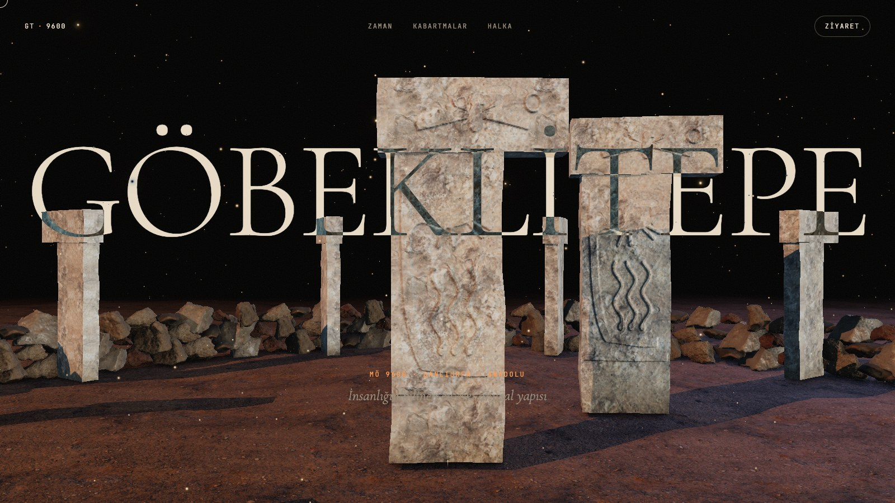

# Göbeklitepe · Gerçekçi 3D Sergi Sitesi



12.000 yıllık Göbeklitepe için ödüllü sitelerin tarzında hazırlanmış, gerçekçi bir 3D sergi sitesi. T biçimli dikilitaşlar, taşa oyulan kabartmalar ve sahnenin tamamı kodla inşa edildi. Kaydırdıkça kamera taşların arasında uçuyor, meşale ışığı yanıyor, toz zerreleri ışıldıyor.

📺 Bu proje [Satır Satır Kod](https://www.youtube.com/@satirsatirkod) YouTube kanalında sıfırdan, satır satır kodlandı.

## Neler var?

- Three.js + GSAP + Lenis ile kaydırma hikâyesi
- Taranmış gerçek dokular (Poly Haven, CC0) ve HDRI gökyüzü ışığı
- T biçimli dikilitaşlar ve taşa geometrik olarak oyulan kabartmalar (tilki, yılanlar, akbaba)
- Gerçek taş taramalarından InstancedMesh ile örülen halka duvarı
- Kendi shader'ımızla ışıldayan toz zerreleri
- GTAO ve bloom ile sinematik son işlemler
- Kaydırınca uçan kamera, meşale ışığı ve yükleme ekranı

## Kullanılanlar

Three.js · GSAP · Lenis · Vite

## Çalıştırma

```bash
npm install
npm run dev
```

Yayın için `npm run build`; çıktı `dist/` klasörüne yazılır.

## Klasörler

- `src/`: sitenin kodu (sahne, dikilitaş, kabartmalar, gürültü, toz)
- `public/`: dokular, taş taraması modeli ve HDRI

## Kaynaklar

Dokular, 3D taş taraması ve HDRI [Poly Haven](https://polyhaven.com)'dan (CC0). Ayrıntılar [KAYNAKLAR.md](KAYNAKLAR.md) dosyasında.

Bu site resmî bir Göbeklitepe sitesi değildir; eğitim amaçlı bir tasarım çalışmasıdır.

## Lisans

Kod [MIT](LICENSE) lisanslıdır. Poly Haven varlıkları CC0 lisanslıdır.
